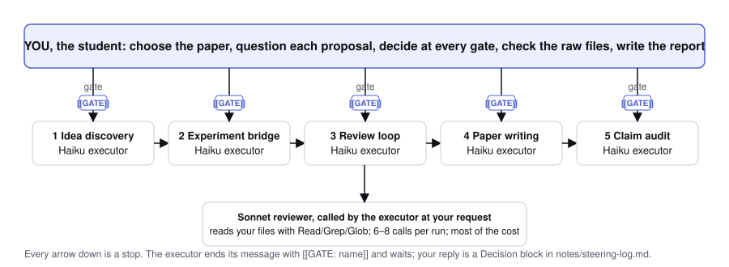
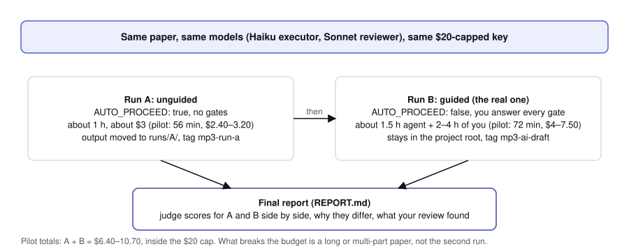
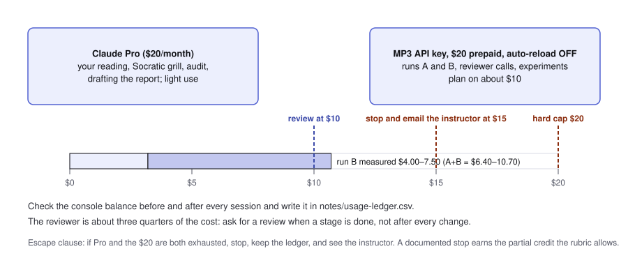
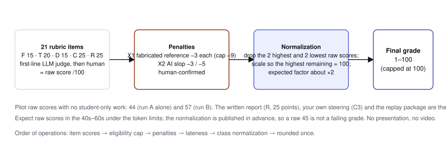
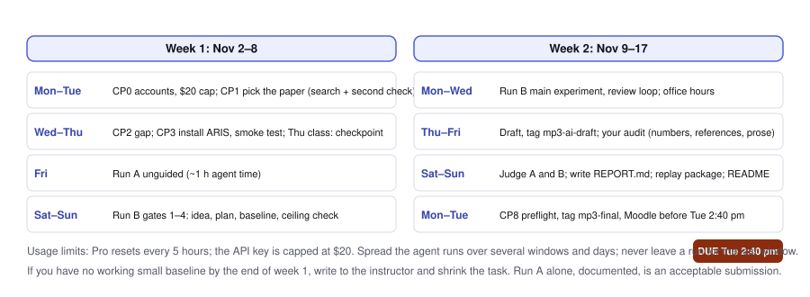

# IPHS 400 · Mini-Project 3: AI Research Factory

**Kenyon College, Fall 2026 · Frontiers in AI · 10% of the course grade**
**Assigned Monday, November 2 · Due Tuesday, November 17, 2026, before class at 2:40 pm Eastern, on Moodle · No presentation: a written report takes its place**
**Instructor: Jon Chun · This repository is private to the class; your own project lives in a separate private repo (manual Part 1).**

## What you will do

> **Plan ahead.** This project will stretch your AI usage. Expect to hit your Pro plan's 5-hour window more than once and to spread the agent runs over several windows and several days. You have two weekends and office hours the week before the deadline: work backwards from Tuesday November 17, 2:40 pm, and never leave a run for the last window. If your budget only stretches to run A, that is an acceptable, documented submission.

You will take a recent arXiv **methods** paper on a technique we studied in class, use the open-source [ARIS](https://github.com/wanshuiyin/Auto-claude-code-research-in-sleep) research skills inside Claude Code to find a gap and propose one improvement, run a small controlled experiment with Claude Haiku as the model under test, and write a short methods paper that you audit by hand. The agent proposes; you question, decide, check and polish. A careful negative result earns full marks.

You run the pipeline **twice on the same paper**:

| | Run A | Run B |
|---|---|---|
| Who steers | nobody (`AUTO_PROCEED: true`) | you, at every gate |
| Purpose | a dry run and your baseline | the real run |
| Agent time, cost (instructor's pilots) | 56 min, $2.40–3.20 | 72 min, $4.00–7.50 |
| Where it lives | `runs/A/`, tag `mp3-run-a` | project root, tag `mp3-ai-draft` → `mp3-final` |

Your **final report** (`REPORT.md`, a quarter of the raw score) scores both runs with the rubric's judge prompt, explains every difference with a file pointer, lists your three steering decisions, answers the three design and three evidence questions in writing, and records what your own audit found in the AI-written draft: numbers that did not trace, references that did not resolve, claims wider than the evidence, AI slop you removed.

## Read in this order

| # | File | What it is for |
|---|---|---|
| 1 | [`mp3-what-to-expect.md`](mp3-what-to-expect.md) | One page: the project, the paper rule, measured costs, how the instructor's two runs scored item by item, the week. Read this first. |
| 2 | [`mp3-self-guided-manual-v6.md`](mp3-self-guided-manual-v6.md) | The step-by-step manual, checkpoints CP0–CP8, every command tested in the instructor's pilots. |
| 3 | [`mp3-grading-rubric-v6.md`](mp3-grading-rubric-v6.md) | Every point: 20 items in five factors (the fifth is the written report), the two penalties, the judge contract the instructor's grader uses, and how the raw score becomes your grade. |
| 4 | [`mp3-report-template.md`](mp3-report-template.md) | Copy to `REPORT.md` in your project and fill all seven sections. |
| 5 | [`mp3-paper-search-prompt.md`](mp3-paper-search-prompt.md) | A prompt that searches arXiv for eligible papers by topic, and a second prompt that argues against your pick before you commit. Both are also embedded in manual §2.1. |
| 6 | [`examples/consistencygate/`](examples/consistencygate/README.md) | The worked example (below). |
| 7 | [`ai-research-ideas_20261030.md`](ai-research-ideas_20261030.md) | A starting list of topics and papers; a search aid, not an approved list. Check every entry's date and page count yourself. |

## The one decision that matters most: the paper

Choose a **recent, short, simple methods paper, about 6–9 pages in total, on one technique from class**: token maxing, context rot and context management, externalizing memory to files, skills, hooks, loop engineering, self-consistency and verification, small benchmarks and harness evaluation. The method should be one mechanism you can state in a sentence, re-run with Haiku in a few hundred calls, and change in one place, **with no new data to collect**. Avoid theory, survey and position papers, systems with many interacting parts, anything that needs training, a GPU, a large dataset or a crawl, and long papers. The instructor's two runs took about an hour of agent time each on a one-mechanism paper; a long or multi-part paper is the one thing that can exhaust your budget and your week. ConsistencyGate (arXiv:2607.22962), the worked example, is excluded as your base paper.

## Budget, and what to do if it runs out

Your Claude Pro plan covers your own reading, questioning and auditing. A separate **Anthropic API key with $20 of prepaid credit, auto-reload off**, pays for the pipeline (manual §0.1 sets it up so $20 is a hard ceiling). If you cannot open an API console account (it needs a payment card), run everything on Pro with waits at the 5-hour resets; no instructor keys are issued. Plan on about $10; the two pilot runs together cost $6.40–10.70. Check the console balance before and after every session: at **$10** stop and cut scope; at **$15** stop and email the instructor; if Pro and the $20 are both exhausted, stop, keep your ledger and see the instructor. A documented stop earns the partial credit the rubric allows.

## How you are graded

The rubric produces a **raw score** out of 100 from 20 items (Functionality 15, Technical Proficiency 20, Documentation 15, Creativity and Extension 25, Report 25). There is no presentation, in class or on video; the report's written design explanations and evidence questions replace it. A first-line LLM judge proposes each item's score with `path:line` evidence; the instructor confirms every one. Two penalties are subtracted after human confirmation: fabricated references (−3 each, cap −9) and AI slop on two sampled pages (−3 or −5).

Under this project's token limits raw scores are expected in the **40s–60s**: the instructor's own two runs scored 44 and 57 before any student-only work. Your MP3 grade is the raw score **normalized across the class**: the two highest and two lowest raw scores are set aside, the rest are scaled so the best of them is 100, and the same scale applies to everyone, capped at 100 (expected factor about 2). This rule is published now, so a raw 45 is not a surprise and not a failure. Do the work in the manual; do not chase the raw number.

## The worked example: `examples/consistencygate/`

The instructor ran the whole pipeline twice on one paper so you can see what to expect and what to hand in.

| Folder or file | What it is |
|---|---|
| `base-paper/` | The original paper, ConsistencyGate (Zhang et al., arXiv:2607.22962, 24 pages): PDF, arXiv HTML, abstract page. For this course only; cite the arXiv page. |
| `trial1-unsteered/` | Run A: the 4-page paper the pipeline wrote with nobody at the gates, its narrative report, reviewer rounds (3/10, "not ready"), experiment results, profile, and its **rubric grade (44/100)** item by item. |
| `trial2-steered/` | Run B: the 7-page paper written with a student answering at 12 gates, references, experiment plan, reviewer rounds (4/10, "almost"), claim audit, decisions log, profile, and its **rubric grade (57/100)**. The student was a model playing a student; its steering log (`steering-log_SIMULATED.md`) shows the *shape* of good gate replies and would earn no authorship credit. |
| `analysis_trial1-vs-trial2.md` | What steering changed: time, calls, cost, review score, errors caught. |
| **`SAMPLE_REPORT.md`** | **The report template filled in from the two runs**: the A/B score table with reasons, three Decision blocks in the required shape, what the audit found. This is the form of what you hand in; its content must be yours. |

Both runs ended in an honest null result: the paper's own method was already perfect on the easy test items, so the proposed change could not show a gain. Read the analysis for why that happened and for the ceiling check (manual §6.2) that prevents it.

## What you hand in (manual Part 9)

- A private GitHub repository the instructor can open, with tags `mp3-run-a`, `mp3-ai-draft` and `mp3-final`.
- `paper/paper.md` and `paper/paper.pdf` (4–8 pages before references), `REPORT.md`, `README.md` with your Generative AI Use Statement, the `notes/` files the manual names, `runs/A/`, raw results and the offline replay (`make smoke`).
- The Moodle submission with the repo URL and final commit SHA, before 2:40 pm on Tuesday November 17.

## Questions

Use the normal course channel. Ask early about a paper you are unsure of; a recorded instructor approval protects your choice. If anything in these documents contradicts something else, the rubric wins, and tell the instructor so it can be fixed for everyone.
