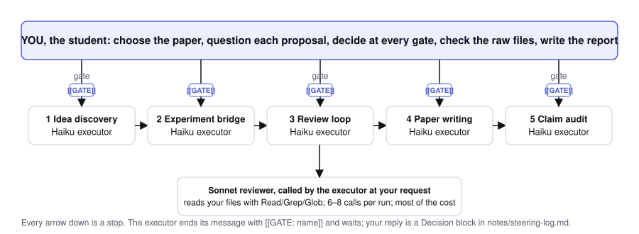
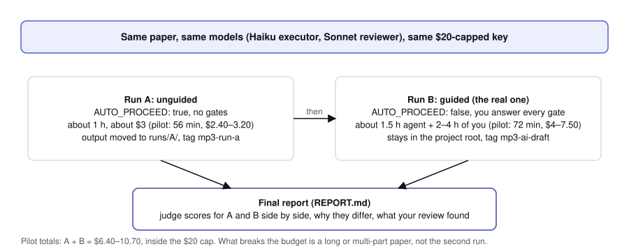
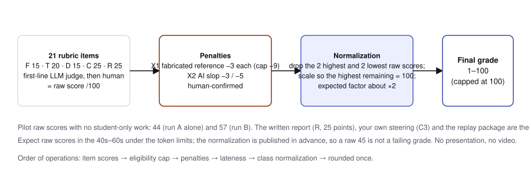
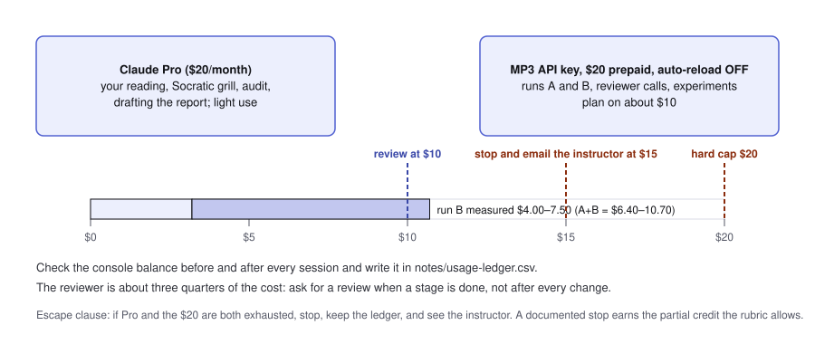
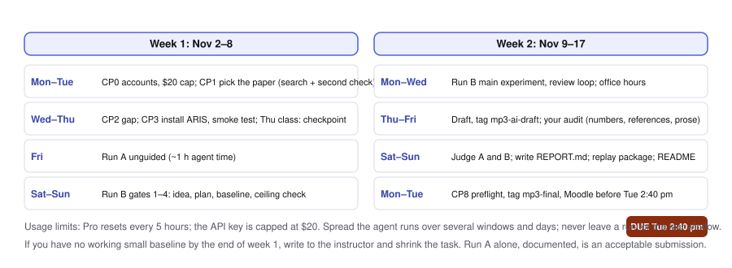

# MP3: what to expect (one page)

**IPHS 400, Fall 2026 · assigned Mon Nov 2 · due Tue Nov 17 before class at 2:40 pm · 10% of the grade · no presentation: a written report instead**

Read this first, then the [manual](mp3-self-guided-manual-v6.md) and the [rubric](mp3-grading-rubric-v6.md). You hand in a repo with three tags, a paper, and a [final report](mp3-report-template.md) that compares your two runs and answers the design and evidence questions in writing.

**This project will stretch your AI usage.** Expect to hit your Pro plan's 5-hour window more than once and to spread the agent runs over several windows and days. You have two weekends and office hours the week before the deadline: plan backwards from Tuesday November 17, 2:40 pm, and never leave a run for the last window.

## The project in one paragraph
You take a recent arXiv **methods** paper, use the open-source ARIS research skills inside Claude Code to find a gap and propose one improvement, run a small controlled experiment with Claude Haiku as the model under test, and write a short methods paper that you audit by hand. The agent proposes; you question, decide, check and polish. A careful negative result earns full marks. You run the pipeline **twice on the same paper**: run A with nobody at the gates (about an hour, about $3), then run B with you answering every gate; your report scores both with the rubric's judge prompt and explains the differences.

## The one decision that matters most: the paper
Choose a **recent, short, simple methods paper (about 6–9 pages in total) on one technique from class**: token maxing, context rot and context management, externalizing memory to files, skills, hooks, loop engineering, self-consistency and verification, small benchmarks and harness evaluation. The method should be one mechanism you can state in a sentence, re-run with Haiku in a few hundred calls, and change in one place, with **no new data to collect**: the paper's own small public task, or a synthetic one you generate and score by script. Avoid theory, survey and position papers, systems with many interacting parts, anything that needs training, a GPU, a large dataset or a crawl, and long papers. With a one-mechanism paper the instructor's runs took about an hour of agent time each and $3–8; a long or multi-part paper is the one thing that can blow the budget and the week. Find candidates with [`mp3-paper-search-prompt.md`](mp3-paper-search-prompt.md). ConsistencyGate (arXiv:2607.22962) is the instructor's example and is off-limits.

## Your grade: raw score, then class normalization (don't worry)
The rubric produces a raw score out of 100. Under this project's token limits raw scores are expected in the 40s–60s: the instructor's two runs scored 44 and 57 before any student-only work. Depending on your paper and your usage you may only have budget for run A; that is an acceptable submission (the run-B checks score 0 against your documented stop, nothing else is capped, and your report compares run A to the instructor's run B). Your MP3 grade is the raw score normalized across the class: the two highest and two lowest raw scores are set aside, the rest are scaled so the best of them is 100, and the same scale applies to everyone, capped at 100. Expect a factor of about 2. Two penalties are subtracted before that: fabricated references (−3 each) and AI slop on two sampled pages (−3 or −5), both human-confirmed; your Part 8 audit is where you remove them. The rule is published now so a raw 45 is not a surprise and not a failure.

## What it costs, measured
The instructor ran the whole pipeline twice on November 2 with exactly your setup (Haiku 5.5 executor and experiment model, Sonnet 5.5 reviewer, `effort: lite`):

| | Trial 1: no human at the gates | Trial 2: a student answered at 12 gates |
|---|---:|---:|
| Agent time, all five stages | 56 min | 72 min |
| Experiment calls (Haiku) | 788 | 374 |
| Reviewer calls (Sonnet) | 8 | 8 |
| Cost at API list prices | $2.40–3.20 | $4.00–7.50 |
| Reviewer verdict | 3/10, "not ready" | 4/10, "almost (scoped claim only)" |

Your budget is your Claude Pro plan plus, if you can open an API console account (it needs a payment card), **$20 of prepaid API credit with a hard cap** (manual §0.1); plan on about $10. Without a card, everything runs on Pro with waits at the 5-hour resets; no instructor keys are issued. Both runs together cost $6.40–10.70 in the pilots, so the two required runs fit with margin. Track the console balance before and after every session: at **$10** stop and cut scope, at **$15** stop and email the instructor, and if Pro and the $20 are both gone, stop, keep your ledger and see the instructor; a documented stop earns the partial credit the rubric allows. The usual cause of an overrun is the paper, not the pipeline. The reviewer is three quarters of the cost, so ask for reviews when a stage is done, not after every change.

 The "student" in trial 2 was a model; its replies took seconds. Budget 10–20 minutes of your own reading per gate, so 2–4 hours across a run, inside the 15–21 hours the manual plans for the week.

## What the two runs produced, and how they score
Both runs found that the paper's own method was already perfect on the easy test items, so the proposed improvement could not show a gain: a null result at the ceiling. The steered run said why, reported counts beside every rate, cut a 288-call experiment to 96 once the debug run showed there was nothing to find, and ended with a cost-only finding (a 2-call gate makes the same decisions as the 5-call gate). You can read all three papers side by side in [`examples/consistencygate/`](examples/consistencygate/README.md).

Graded against the rubric by an independent model (GPT-6.1 Sol), the two runs score as follows; a sample final report built from them is [`examples/consistencygate/SAMPLE_REPORT.md`](examples/consistencygate/SAMPLE_REPORT.md). Neither had a student, a human audit or a video, so the student-only items are 0; that is the point of the table: it shows which points the pipeline earns for you and which ones only you can earn.

| Item (max) | Trial 1, no steering | Trial 2, steered | What only you can supply |
|---|---:|---:|---|
| F1 Baseline implemented (5) | 5 | 5 | |
| F2 Reproduction package (5) | 0 | 1 | README, `uv.lock`, `make smoke` replay, the ≤20-call live check |
| F3 Controlled comparison (5) | 3 | 5 | counts beside rates, discordant items beside paired CIs |
| T1 Targeted orchestration (4) | 2 | 3 | the logged `/research-pipeline` entry command |
| T2 Independent review (4) | 3 | 4 | |
| T3 Stage handoffs (4) | 4 | 4 | |
| T4 Plan, recovery, safety (4) | 0 | 2 | ceiling check in the plan, usage ledger, normal permissions, recovery note |
| T5 Numerical provenance (4) | 4 | 4 | |
| D1 Reference identity (6) | 4 | 6 | every reference with first author, year and ID (trial 1 dropped the author) |
| D2 Citation support (3) | 3 | 3 | |
| D3 Human audit and paper (4) | 1 | 2 | `paper/paper.md`, the two tags, your audit notes |
| D4 README and disclosure (2) | 0 | 0 | README with the AI-use statement and backends table |
| C1 Gap and novelty (6) | 4 | 6 | |
| C2 Method contribution (7) | 6 | 7 | |
| C3 Student steering (7) | 0 | 0 | your own decisions, as `### Decision N` blocks with raw pointers |
| C4 Critical appraisal (5) | 5 | 5 | |
| R1–R4 Report (25) | 0 | 0 | the written final report: A/B comparison, design explanations, evidence questions |
| **Total (100)** | **44** | **57** | |
| Excluding the report (75) | 44 | 57 | |

Read the table this way. The pipeline on its own, with no steering, earns about 44 points; with steering it earns 57 and a better paper, and that is before anything only a student can add. The 43 points trial 2 did not earn are almost all yours to take: the written report (25), your own steering (7; trial 2's replies had the right shape but were model-written, so by rule they score 0), the reproduction package and README (6), the ledger and permissions (2), and the Markdown paper with its audit trail (2). A student who runs the pipeline as trial 2 did and then does Parts 7–10 of the manual is on course for the 80s and 90s; one who runs it as trial 1 did and submits what comes out is in the 40s. Grader: GPT-6.1 Sol via Codex, a different model family from the Haiku executor and Sonnet reviewer, first-line proposals with path:line evidence; the full reports are in the trial folders.

## What the agent will not do unless you ask
At `effort: lite` the executor takes the shortest path. In the trials it skipped ARIS's evidence-gate helpers, ran two novelty searches instead of the full search, did not review the experiment results, and in paper writing skipped planning, figures and the citation audit. It also runs straight past checkpoints unless `AUTO_PROCEED: false` is set and your `CLAUDE.md` tells it to stop with a `[[GATE: …]]` line (manual §4.4). Ask for what you need by name.

## How to answer at a gate (the shape that scores)
1. Open the file the agent names and check one number against a raw file (`results/…/*.jsonl`, a log, a raw reviewer reply). Say what you opened and the line.
2. Ask the question that could make the test fail: Is the baseline already at 0% or 100%? What is the control, and is it matched on calls? Are the stop rules written down before the run? Is this number from the current file?
3. Decide: `DECISION: ACCEPT | REJECT | MODIFY — <one line>`, then the fact, constraint or argument that is yours. Agreeing with good advice is fine; do not invent disagreement.
4. Say how many experiment calls and reviewer calls you allow before the next gate.

Write it in Claude Code as your answer and copy it into `notes/steering-log.md` as a `### Decision N` block (manual Part 3). The grader reads your exported transcript, so the words must be yours.

## The week

| Day | Checkpoint |
|---|---|
| Week 1, Mon–Tue | CP0 accounts and the $20 cap; CP1 pick the paper (the decision above) |
| Week 1, Wed–Thu | CP2 read it and write the gap; CP3 install ARIS and smoke-test the reviewer; Thursday class is a checkpoint |
| Week 1 Fri – week 2 Wed | CP4 run A unguided, then run B one gate at a time; CP5 baseline, ceiling check, then the main run; office hours |
| Week 2, Thu–Sun | CP6 draft and tag `mp3-ai-draft`; CP7 your audit of numbers, references and prose; judge A and B; write REPORT.md |
| Mon–Tue Nov 16–17 | CP8 preflight, tag `mp3-final`, submit on Moodle before 2:40 pm Tuesday |

If you do not have a working small baseline by the end of week 1, write to the instructor and shrink the task. Do not answer with a bigger run.
